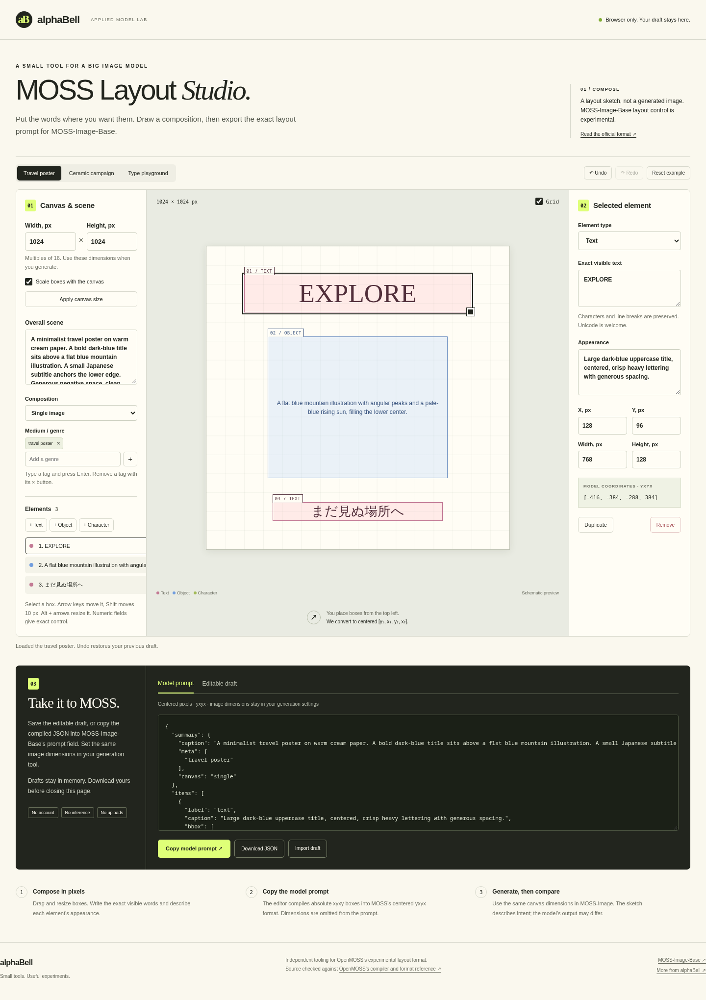

# MOSS Layout Studio

Draw a poster, place exact text, and export the JSON layout for MOSS-Image-Base's experimental layout prompts. An independent alphaBell project.

**[Try MOSS Layout Studio](https://huggingface.co/spaces/alphabell/MOSS-Layout-Studio)** · [Source and checks](https://github.com/alphabell-research/moss-layout-studio)



Move and resize text, object and character boxes on a canvas. Keep Chinese copy, emoji and intended line breaks intact. Import an existing layout to edit it, or start from a composition preset.

## Blind-check two generated images

[**Open the blind layout check**](https://alphabell-moss-layout-studio.static.hf.space/evaluate.html). Import one Studio draft or compiled MOSS layout prompt, then choose a Base output and an SFT output in separate fields. The page randomizes their display order and hides file names while you inspect them.

The dedicated [MOSS Blind Layout Check Space](https://huggingface.co/spaces/alphabell/MOSS-Blind-Layout-Check) offers the same evaluator as a direct entry point. Its package is generated by [`standalone/build.py`](standalone/build.py) from this canonical Studio source; CI checks that the parser, scoring code and styles are byte-identical.

For each target text region, transcribe what is actually visible and draw or enter its observed box. You can mark text missing or illegible. After both sides are complete, reveal the labels and download a JSON record with literal text scores, placement overlap, source revisions, image SHA-256 hashes and your manual annotations. Image bytes stay in the browser tab and are never exported. Compiled prompts omit dimensions, so enter the original generation width and height; both uploaded images must match them. The evaluator reuses the Studio parser and checks Unicode graphemes without OCR or inference.

This is a check of one user-supplied image pair. Differences in seeds, crops, prompts and generation settings may affect the result. The [pinned MOSS-Image-SFT model card](https://huggingface.co/OpenMOSS-Team/MOSS-Image-SFT/blob/f972bd4b4b9e3852133cc5da954d87bc32cd8fb9/README.md) supplies the motivation for a paired layout check; this page does not claim a general model ranking.

The evaluator accepts a layout JSON smaller than 1 MB, up to 50 text regions of 1,000 graphemes each, and two images up to 20 MB each. Its display supports original dimensions up to 8192 pixels per side. These are browser-tool limits, separate from the publisher's model format.

The editor runs in your browser. It prepares layouts without model inference. Its wireframe shows placement and text, rather than a generated image. Drafts remain in memory until you download them; there is no autosave, analytics or uploaded prompt content.

## Two exports for two jobs

**Editable draft** keeps the canvas `width` and `height`, with top-left-origin absolute-pixel boxes in `[x_min, y_min, x_max, y_max]` order. Save this format to keep editing.

**Model prompt** uses center-origin absolute pixels in `[y_min, x_min, y_max, x_max]` order. It omits dimensions, following the upstream compiler. Use it with the same output width and height in your MOSS-Image generation settings.

For example, on a 1536 by 1024 canvas, a cup occupying `[176, 224, 800, 864]` in the draft becomes `[-288, -592, 352, 32]` in the model prompt. Fractional draft edges are enclosed at pixel boundaries before the canvas center is subtracted.

When importing a model prompt, choose its original canvas dimensions first. An editable draft carries its own dimensions. Resizing the editor canvas scales the composition when **Scale boxes with the canvas** is selected. With it off, pixel positions stay fixed; a resize that would put boxes outside the canvas is rejected. Changing dimensions in an upstream draft alone does not rescale its boxes.

Known optional metadata, palettes and item tags survive import and export. Unknown fields and duplicate JSON keys produce an error instead of silently discarding content. Editor IDs stay out of both exports. Overlapping items are allowed.

## Format reference

The coordinate convention follows the official [MOSS-Image user guide](https://github.com/OpenMOSS/MOSS-Image/blob/52b87fca23acedc399d062d593bec388aee9926a/USERGUIDE.md#layout-prompts-experimental). Editable-draft validation and compilation follow the [layout reference](https://github.com/OpenMOSS/MOSS-Image/blob/52b87fca23acedc399d062d593bec388aee9926a/skills/moss-image-prompt-enhancer/references/layout.md) and [compiler](https://github.com/OpenMOSS/MOSS-Image/blob/52b87fca23acedc399d062d593bec388aee9926a/skills/moss-image-prompt-enhancer/scripts/compile_prompt.py) at revision `52b87fca23acedc399d062d593bec388aee9926a`.

Dimensions must be positive integer multiples of 16. Resolution recommendations appear separately from format validation. The browser editor additionally requires dimensions within JavaScript's safe integer precision. Layout adherence and text rendering are properties of the image model and generation settings; this tool checks the layout representation.

The visual editor accepts canvas edges up to 8192 px and imported layouts with up to 200 elements in files smaller than 1 MB. These are interactive-editor limits, separate from the upstream schema and your generation hardware's capacity.

## Run and verify

Serve this directory with a static HTTP server, then open `index.html`.

```sh
python3 -m http.server 8000
```

The test suite needs Node.js and Python 3, with no model weights or third-party Python packages:

```sh
node --test tests/layout.test.mjs
node --test tests/evaluate.test.mjs
python3 tests/reference_check.py
```

For the browser checks, install Playwright and Chromium, then run:

```sh
python3 -m pip install -r requirements-dev.txt
python3 verify.py
python3 verify_evaluator.py
```

The browser suite covers all three presets, exact JSON round trips and downloads, keyboard movement and resizing, real touch dragging and resizing, mobile layout, undo and redo, strict imports, literal HTML text, clipboard denial and outbound network isolation. It also accepts `--base-url` to check a hosted static deployment.

The reference check compares 494 accepted and rejected draft inputs with an unchanged, hash-checked copy of the pinned upstream Python compiler. It covers non-square canvases, random layouts, edge rounding, Unicode, optional metadata, invalid geometry, duplicate keys and integer-literal dimensions. The separate module tests exercise import/export and editor resize behavior.

## License

Apache-2.0. See `LICENSE` and `NOTICE` for the upstream compiler reference and browser adaptation.
